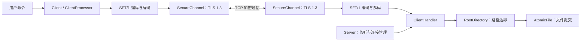
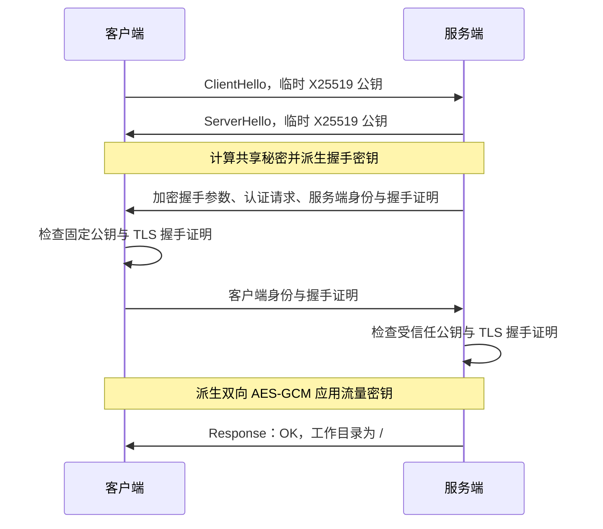
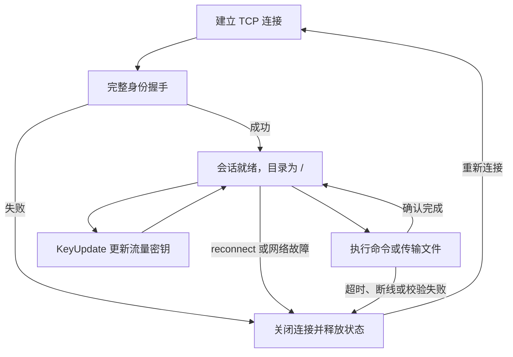
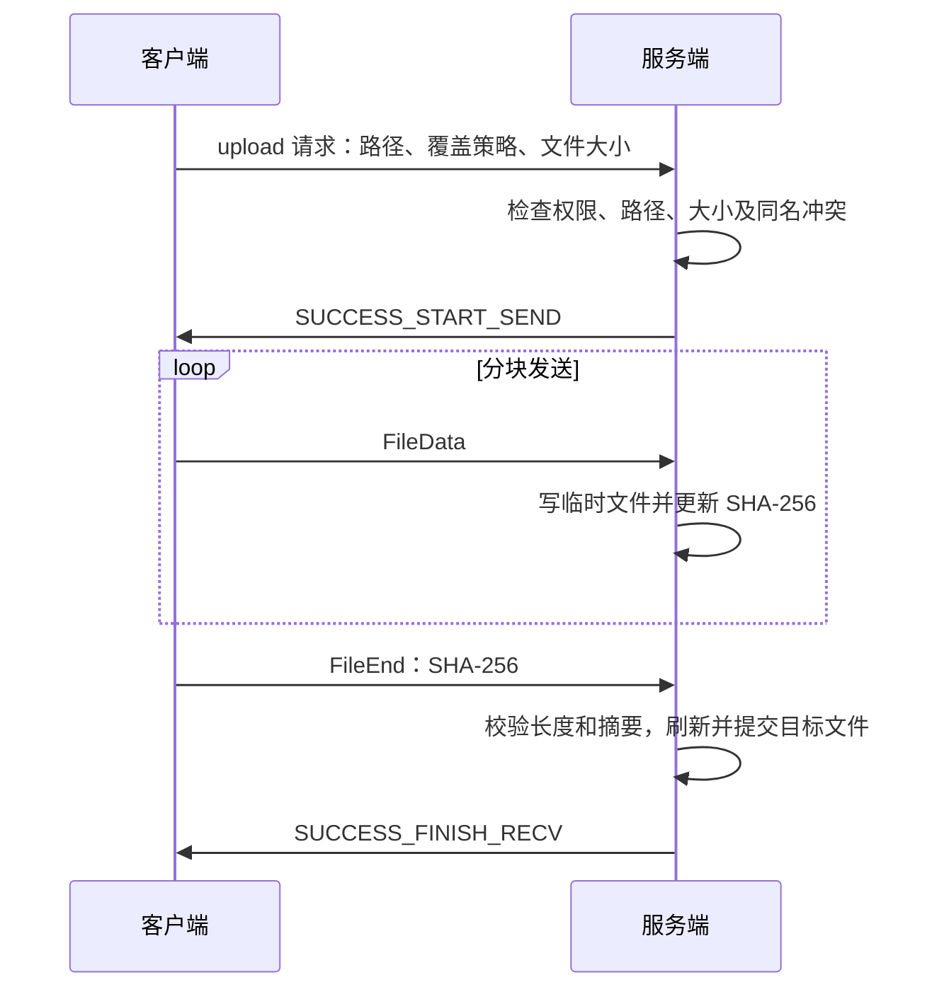

# 软件与系统安全安全实验报告——文件安全传输系统

> 姓名：张凯扬
>
> 学号：202618008629006

### 一、实验任务：

1. **设计一种安全的传输协议SFT/1（笔者本科计算机网络课程实验中，笔者设计的传输协议的安全版本）**

2. 实现一个能在macOS、Linux、Windows三个平台编译运行的文件安全传输程序。共用同一份源码，可以给三个平台分别编译可执行文件；将服务端和客户端集成在同一个程序中。

3. 命令行方式运行，可以配置监听/连接地址、端口、共享目录、本地目录等参数。

4. 支持文件上传、下载，以及ls、cd、mkdir、rm、rm -r等目录操作。

5. 使用本地预存的对方公钥验证身份，认证通过之后才能进行文件操作。

6. 网络传输加密，同一条连接上可以连续传多个文件。

7. 处理断线、超时、重新握手、同名文件冲突、传输中断这些情况。

8. 文件分块流式传输，避免内存占用随文件大小增高。

9. 输出连接状态、操作结果、传输进度和差错信息，并通过功能测试和安全测试来验证。

### 二、实验内容：

​	用C++17编写一个跨平台的文件安全传输工具。程序里同时包含服务端和客户端两种角色，启动时通过子命令选择：keygen生成密钥、fingerprint显示公钥指纹、server启动服务端、client启动客户端。

​	服务端启动后监听指定端口，每有一个客户端连进来就开一个线程，各自维护自己的工作目录，互不干扰。客户端连上之后，可以通过命令交互或者UTF-8命令文件来执行操作。

​	实现的是自定义的SFT/1应用层协议，不是标准FTP，但用法和FTP的交互方式差不多。

#### 1. 功能设计：

软件中所设计的命令如下：

- **ls**：列出当前远端目录下的文件和文件夹。

- **pwd**：显示相对于共享根目录的虚拟路径。

- **cd [path]**：进入指定目录，不带参数则回到共享根目录。

- **mkdir path**：在共享目录内新建文件夹。

- **upload [-o] local [remote]**：上传本地文件，可以指定远端名称；默认不允许覆盖已有文件，加-o才会覆盖。

- **get [-o] remote [local]**：下载远端文件，可以指定本地名称；本地已有同名文件时加-o会自动在文件名后追加.L再保存，避免覆盖掉原来的文件。

- **rm path**：删除远端普通文件。

- **rm -r path**：递归删除远端目录，禁止删除共享根目录本身。

- **rekey**：在当前连接里触发一次TLS流量密钥更新。

- **reconnect**：断开当前连接，重新进行完整的身份认证和密钥协商。

- **exit**：退出客户端。

​	如果参数中包含空格，用单引号或双引号包起来。

#### 2. 安全目标：

​	前提：参考ssh的密钥登录设计方式，假设双方已经预先通过某种可信的方式交换过公钥。

​	主要防护目标：未授权的客户端连接、连接假冒的服务端、传输内容被窃听或篡改、抓到的密文被原样重放、路径越界访问共享目录之外的文件、收到畸形消息导致崩溃、传输中断导致目标文件残废。

### 三、实验环境：

#### 1. 开发与构建环境：

| 项目 | 配置 |
|---|---|
| 开发主机 | macOS，Apple Silicon / arm64 |
| 编程语言 | C++17 |
| 原生编译器 | AppleClang 21 |
| 构建系统 | CMake 3.20+，支持Ninja |
| 密码库 | OpenSSL 3.x；交付的可执行文件静态链接OpenSSL 3.5.9 |
| Windows构建 | MinGW-w64交叉工具链 |
| Linux构建 | Zig 0.15.2，目标x86_64-linux-musl |
| 测试工具 | Python 3、OpenSSL CLI、CTest、AddressSanitizer、UndefinedBehaviorSanitizer |

#### 2. 平台交付状态：

| 目标平台 | 可执行文件 | 当前验证情况 |
|---|---|---|
| macOS arm64 | `binaries/macos-arm64/sft` | 原生构建、运行和集成测试通过 |
| Linux x86_64 | `binaries/linux-x86_64/sft` | 交叉构建成功，ELF完全静态链接； |
| Windows 10/11 x86_64 | `binaries/windows-x86_64/sft.exe` | 交叉构建成功，仅依赖Windows系统DLL； |

​	每个平台的程序都同时包含服务端和客户端两种角色。

### 四、软件设计：

#### 1. 总体架构：

​	系统按命令交互、会话管理、消息协议、安全通道、网络连接和文件存储这几个模块来组织。



​	主要类及职责如下：

| 类 | 职责 |
|---|---|
| `Server` | 监听连接，限制并发，建立和回收会话线程，停止服务 |
| `ClientHandler` | 维护单个客户端的工作目录，验证请求并执行服务端操作 |
| `Client` | 建立连接，管理客户端生命周期，处理重新连接 |
| `ClientProcessor` | 处理用户命令、上传下载、响应显示和进度反馈 |
| `SecurityContext` | 加载Ed25519身份与信任公钥，设置TLS安全策略 |
| `SecureChannel` | 完成握手、加密读写、超时处理以及流量密钥更新 |
| `Protocol` | 帧编码、完整收发、命令与文件传输状态控制 |
| `RootDirectory` | 解析虚拟路径，限制访问范围并拒绝链接路径 |
| `AtomicFile` | 独占创建临时文件，流式写入，校验后的原子提交与失败清理 |
| `FileDigest` | 对文件块做增量SHA-256计算 |

#### 2. 程序流程与线程设计：

​	程序启动后先解析子命令和参数。服务端先加载自己的私钥和允许连接的客户端公钥，初始化共享根目录，然后绑定地址和端口开始监听。每有一个客户端连进来，就分一个独立线程去跑`ClientHandler::handle`，认证完成后发送共享根目录`/`作为欢迎响应。

​	客户端启动时加载自己的私钥和服务端公钥，建立TCP连接后做一次完整的TLS握手，收到服务端的欢迎响应后进入命令循环。客户端在一条连接上顺序执行请求，当前操作确认完成才开始下一条，不会在一条连接上并行发多个操作。

​	每个服务端会话独立维护`currentPath`，所以远端目录切换不会影响进程的工作目录，保障多客户端运行的稳定性。共享文件系统操作用互斥锁协调，网络等待的时候不长期占用锁。完成的线程会被回收；停止服务时先取消监听和连接I/O，再等待线程结束。

#### 3. 通信协议：

​	TCP提供的是有序字节流，没有消息边界，因此在应用层精心处理每条消息的类型和长度，关键情况是短读、短写以及多个帧“粘包”一起到达。

​	SFT/1在TLS解密后的字节流上加了一个固定12字节的帧头：

| 字段 | 长度 | 含义 |
|---|---:|---|
| `magic` | 4字节 | 固定标识`SFT1` |
| `version` | 2字节 | 协议版本，当前为1 |
| `type` | 2字节 | 消息类型 |
| `payload_length` | 4字节 | 帧体精确字节数 |
| `payload` | 变长 | 指定长度的数据 |

​	多字节整数统一用大端编码。接收方先读满帧头，检查版本、类型和长度上限，再分配并读满帧体。最大帧体长度256 KiB，超限的消息在分配内存之前会被拒绝。

| 消息 | 类型编号 | 内容 |
|---|---:|---|
| `Command` | 1 | 操作名及参数组成的字符串字段数组 |
| `Response` | 2 | `OK`或`ERROR`加具体提示信息 |
| `FileMeta` | 3 | 8字节精确文件大小 |
| `FileData` | 4 | 1至65536字节的文件数据 |
| `FileEnd` | 5 | 32字节SHA-256摘要 |

​	命令字段数组由字段数量、各字段长度和字段内容组成，不依赖空格或特殊结束字节来拆分网络消息。文件总大小和偏移用64位整数；文件内容可以是任意字节，即使其中出现了与协议标识一样的字节序列也不会误判成控制信息。

#### 4. 身份认证与会话密钥：

​	双方各自生成Ed25519身份密钥对，私钥只保存在本机，并在本地保存对方的PEM格式公钥。公钥通过可信渠道交换，用原始32字节公钥的SHA-256指纹来核对。

​	这里Ed25519负责签名，X25519负责协商密钥，两者分工不同。

​	程序为本机身份生成一个内存中的自签名证书，作为TLS身份载体。验证对端时，从证书里提取Ed25519公钥，与本地信任公钥匹配，同时检查证书有效期和自签名。与传统TLS不同，这里身份的信任依据是固定公钥，而不是CA。TLS的握手证明则验证对端确实持有对应私钥，并把身份绑定到本次握手上下文里。

​	密码配置固定为：

```text
协议版本：TLS 1.3
签名算法：Ed25519
临时协商组：X25519
密码套件：TLS_AES_256_GCM_SHA384
应用协议：sft/1
会话票据：关闭
会话恢复：关闭
0-RTT：关闭
```



​	会话密钥由TLS 1.3的密钥计划派生，双向使用不同的流量密钥。应用程序不直接传送明文AES密钥，也不自行管理AES-GCM的nonce，这些都交给OpenSSL按TLS标准来实现。

#### 5. 多文件会话、换钥与重新握手：

​	身份握手完成后，同一条连接可以连续上传或下载多个文件，在当前密钥有效期间复用会话密钥。文件边界不会重置TLS记录计数器，区别了文件序号和nonce。不同方向的记录保护由各自的密钥和状态管理。

​	为限制单个流量密钥的使用量，发送方向累计发送约256 MiB后会自动请求一次TLS KeyUpdate；用户也可以输入`rekey`主动触发。KeyUpdate不重新交换Ed25519身份或X25519协商，只更新现有连接的流量密钥。

​	重新连接则是另一套流程：关闭原连接，释放TLS状态，重新创建TCP和TLS对象，重新验证双方身份，生成新的临时协商材料。系统禁用了会话恢复和0-RTT，并检查握手确实没有复用旧会话。新会话工作目录重置为`/`，不延用中断的文件接收状态。



#### 6. 文件传输与提交：

​	发送端按64 KiB的块读文件，每读一块算一次增量摘要然后发出去；接收端把每块数据写到目标目录下的一个随机临时文件里，同时计算自己的摘要。内存占用主要和连接数、消息帧和TLS缓冲有关，不需要把整个文件读进内存，因此与传输文件大小关系不大。

​	上传流程如下：



​	下载时，服务端先返回文件大小，客户端确认能接收后，服务端开始发送文件块。客户端完成校验和本地提交后回复确认，服务端再发最终完成响应。

​	临时文件用独占创建加随机名称，避免同名并发写入互相覆盖。没有覆盖授权时，提交过程原子地拒绝已存在的目标；允许覆盖时，通过文件系统的替换操作把完整的新文件提交上去。如果在提交前发生断线、摘要不匹配或者普通I/O错误，临时文件会被清理掉，已有目标不会被一个半成品替换。

​	为了避免数据传输出现损坏，进度条仅仅展示进度，例如100%表示数据全部发送完成，最终是否成功需要接收端提交确认。如果文件已经提交但确认消息在传输过程中丢失，发送端无法确定最终结果，故系统不会自动重放覆盖或删除操作。

#### 7. 文件访问边界与资源管理：

​	服务端只在指定的共享根目录内提供文件访问，对客户端暴露`/`开头的虚拟路径。路径解析按组件处理`.`和`..`，禁止跳出共享根目录。已有的符号链接和Windows reparse point会被拒绝。

​	其中，身份和信任文件必须放在共享根目录之外。

| 参数 | 默认值 | 作用 |
|---|---:|---|
| `--port` | 5005 | TCP端口 |
| `--timeout` | 30秒 | 连接、握手及完整I/O操作超时 |
| `--max-file-size` | 10 GiB | 单个文件大小上限 |
| `--max-clients` | 32 | 同时接纳的连接数上限 |
| `--retries` | 3 | 客户端建立新连接的尝试次数。新建连接时若失败至多重试几次，而非自动重放文件操作。 |
| `--read-only` | 关闭 | 只允许目录查询、目录切换和下载 |

​	当前所有受信任客户端共用服务实例的权限和共享目录，没有每用户独立ACL和配额。

#### 8. 差错处理：

​	空闲状态下的参数或文件操作错误，若返回`ERROR`，则连接可以复用。文件传输开始之后，如果出现非法块、长度错误、摘要不匹配或磁盘写入失败，系统则会直接终止连接，避免把剩余的文件字节误解析成下一条命令。TCP EOF、取消和超时同样进行清理流程。

​	部分提示码如下：

| 提示码 | 含义 |
|---|---|
| `SUCCESS_START_SEND` | 服务端已准备接收上传文件 |
| `SUCCESS_FINISH_RECV` | 文件接收、校验与提交完成 |
| `SUCCESS_SEND_FINISH` | 下载流程双向确认完成 |
| `SUCCESS_CREATED` | 创建目录成功 |
| `SUCCESS_DELETED` | 删除操作成功 |
| `SUCCESS_KEYS_UPDATED` | 主动换钥请求处理完成 |
| `FAIL_INVALID_COMMAND_FORMAT` | 命令参数不符合要求 |
| `FAIL_EXISTED_NO_OVERWRITE` | 目标已存在且没有覆盖授权 |
| `FAIL_OUTSIDE_ROOT` | 请求路径越过共享根目录 |
| `FAIL_READ_ONLY` | 当前服务实例禁止写操作 |
| `FAIL_FILESYSTEM_OPERATION` | 文件系统操作失败 |

​	详细的网络异常都在当前会话内处理，因此单个客户端出错不会导致服务进程异常中指。日志不会输出私钥或会话密钥。

### 五、实验结果演示及分析：

#### 1. 实验步骤：

​	以下命令用于复现实验，`sft`表示当前平台的可执行程序。运行时需替换为实际路径，或者将程序放入命令搜索路径。在macOS上，可以用`./binaries/macos-arm64/sft`。

**第一步：生成并交换身份公钥。**

​	服务端主机执行：

```sh
sft keygen --key server.key --public server.pub
sft fingerprint --public server.pub
```

​	客户端主机执行：

```sh
sft keygen --key client.key --public client.pub
sft fingerprint --public client.pub
```

​	双方通过可信渠道交换`.pub`文件并核对指纹，私钥保留在各自主机上。生成命令会拒绝覆盖已经存在的密钥文件。

**第二步：启动服务端。**

```sh
sft server --key server.key --peer client.pub --root shared --host 127.0.0.1 --port 5005
```

​	该命令用于本机实验。跨主机连接时，可以把监听地址显式设置为相应网卡地址或`0.0.0.0`。多个受信任客户端可以用`--trust-dir`配置公钥目录，替代单个`--peer`文件。

**第三步：启动客户端。**

```sh
sft client --key client.key --peer server.pub --host 127.0.0.1 --port 5005 --local local_files
```

​	准备待传输文件并放入本地目录。认证成功后，可以执行：

```text
ls
mkdir "实验 文件"
cd "实验 文件"
upload "示例 文本.txt"
upload image.png
get "示例 文本.txt" "下载 文本.txt"
get image.png downloaded.png
pwd
rekey
cd /
reconnect
pwd
exit
```

**第四步：执行自动化测试。**

​	在项目根目录执行：

```sh
python3 source/tests/integration.py binaries/macos-arm64/sft
python3 source/tests/large_transfer.py binaries/macos-arm64/sft
```

​	测试在临时目录和本机随机端口运行，独立生成测试身份运行。标准测试覆盖功能和异常场景；大文件测试使用Release程序，验证连续传输及自动换钥。

#### 2. 功能与安全测试：

​	下表中的"通过"均指macOS本机运行的结果。

| 测试项目 | 测试方法 | 结果 |
|---|---|---|
| 空文件及小文件 | 传输0、1、2、1023、1024、1025字节文件 | 通过，长度与摘要一致 |
| 文件块边界 | 传输65535、65536、65537字节文件 | 通过 |
| 任意二进制内容 | 传输随机数据及包含特殊标记字节的文件 | 通过，内容未被当作结束符 |
| 文件名兼容 | 使用中文、空格及长文件名 | 通过 |
| 同会话多文件 | 一次认证后连续上传和下载多个文件 | 通过，无逐文件重新握手 |
| 同名冲突 | 默认上传已有文件，再使用`upload -o` | 默认拒绝覆盖，显式覆盖成功 |
| 下载改名 | 对已有本地文件执行`get -o` | 追加`.L`，原文件不被覆盖 |
| 主动换钥 | 执行`rekey`后继续传输 | 通过 |
| 公钥认证 | 使用错误服务端公钥或未授权客户端身份 | 连接被拒绝，未执行文件操作 |
| 协议降级 | 使用TLS 1.2建立连接 | 被拒绝 |
| 帧分段与合并 | 逐字节发送帧，合并多个命令帧发送 | 解析正确 |
| 畸形帧 | 发送超限帧头、错误块长度或错误摘要 | 拒绝处理，不提交文件 |
| 路径边界 | 尝试越界路径、链接路径及保留名称 | 被拒绝 |
| 只读与大小限制 | 启用只读服务、设置较小文件上限 | 写入或超限上传被拒绝 |
| 中断上传 | 上传部分数据后关闭连接 | 临时文件被清理，已有目标内容保持完整 |
| 密文篡改 | 在转发代理中修改加密记录 | TLS校验失败，操作未执行 |
| 密文重放 | 在同连接或新连接重放捕获记录 | 被拒绝 |
| 并发连接 | 四个已认证客户端同时上传 | 通过，文件内容一致 |
| 超时与停止 | 发送不完整消息，或在连接存续时停止服务 | 超时关闭或正常清理，无停服挂死 |

​	标准集成测试的实际输出摘要如下，完整记录见[binary-integration.txt](evidence/binary-integration.txt)：

```text
PASS: binary/Unicode/long filenames, multi-file session, fresh reconnect, rekey, overwrite,
      mutual pins, framing, traversal/link rejection, atomic cleanup, hash/size limits,
      ciphertext tampering/replay rejection, concurrent clients, timeout and shutdown.
```

#### 3. 断线重连实验：

​	测试先让客户端建立连接并进入一个远端子目录，随后停止服务端，此时客户端下一次写请求直接面对一个失效连接。客户端报告操作失败，并且不会自动重放这个写请求。然后，在相同端口重新启动服务端，客户端执行下一条新命令时会重新建立TCP/TLS连接。

​	测试观察到两次独立的完整握手，新会话工作目录是`/`，失败请求对应的目录没有因为重连被自动创建。这说明连接状态和文件操作状态是隔离的，重新握手后会话也会从头初始化。

​	不过，重连并不等于断点续传。本系统中断的文件只能从头重传；而且确认消息丢失时，文件实际可能已经提交成功了，所以要根据实际情况决定是否重试。

#### 4. 大文件与内存实验：

​	单独进行了一次270 MiB文件的上传和下载，文件精确大小283115520字节。在同一条连接上完成往返传输，上传和下载分别跨过了256 MiB的自动流量密钥更新阈值，最终文件长度和SHA-256一致。

| 指标 | 结果 |
|---|---|
| 单文件大小 | 270 MiB，283115520字节 |
| 连接数量 | 一条已认证会话 |
| 完整握手次数 | 一次 |
| 自动换钥 | 传输跨过配置阈值后仍正常完成 |
| 内容一致性 | 原文件与下载文件SHA-256相同 |
| Release子进程峰值内存 | 约6.5 MiB（本次运行） |

​	具体输出见[large-transfer.txt](evidence/large-transfer.txt)。另外，超过32位的文件大小只做了元数据与接收准备的验证，没有实际完整传过超过2 GiB的文件；10 GiB只是默认限制，并不是实测的最大文件限制。

#### 5. 源码构建与内存检查：

​	整理后的`source`目录在独立构建目录重新配置和编译，并通过了CTest集成测试，记录见[source-integration.txt](evidence/source-integration.txt)。这说明当前目录中的构建配置、文件路径和测试入口是可以独立使用的。

​	专用AddressSanitizer和UndefinedBehaviorSanitizer构建跑了同一套集成用例，全部通过，没有检测到内存越界或未定义行为。

#### 6. 结果分析与验证边界：

​	从实验结果来看，显式长度分帧可以正确处理消息分段和合并；流式读写让单连接内存不随文件大小线性增长；双方固定公钥加TLS记录校验可以挡住测试中的错误身份、篡改和重放；完整握手加上禁止操作自动重放，约束了断线后的恢复行为。

### 六、实验总结和心得体会

#### 1. 遇到的问题和解决过程：

​	TCP收发次数和应用消息数量对不上：通过固定帧头、明确长度、读满和写满循环，让文件内容和协议控制信息都能按既定结构解析出来。

​	长期身份密钥和临时协商密钥的职责容易混在一起：最后选择用Ed25519做身份签名，用X25519做临时密钥协商，把握手和记录保护整体交给成熟的TLS实现，避免在应用层自己管理密码状态。

​	同一条连接传多个文件时，复用密钥必须同时维持正确的nonce和记录序列状态：这块靠TLS记录层和KeyUpdate来管理，让连续传输和限制密钥使用量之间有一个明确的生命周期。

​	网络异常不能简单等同于"操作没执行"：接收端可能已经提交文件了，发送端只是还没收到确认。所以系统选择报告"未确认"状态并禁止自动重放，让覆盖、删除这类操作的行为可判断。

​	接收数据时直接覆盖目标文件的话，一旦中断可能导致原文件损坏：所以用临时文件加长度摘要校验加原子提交的方式，把正常传输失败的影响限制在临时文件范围内。

​	跨平台差异比预想多：网络句柄、初始化、Unicode命令行、文件权限、原子提交接口在不同系统上都不一样。最后把差异集中在封装层，公共业务逻辑统一用标准C++类型和同一套协议。

#### 2. 收获和提高：

​	通过实践深入理解了TLS 1.3的握手流程、密钥派生和记录保护机制，以及Ed25519、X25519这些现代密码算法各自承担的角色。

​	掌握了OpenSSL 3.x的API使用，包括证书加载、TLS上下文配置、KeyUpdate接口等。

​	把网络编程、密码学接口、文件系统、线程生命周期和异常处理结合到了同一个应用里，体会到安全文件传输不只是"把文件加密传过去"这么简单，还要考虑身份可信、消息可解析、会话状态明确，以及失败后文件状态可判断。

​	学会了为功能和异常情况设计可重复的自动化测试，把验证从正常路径扩展到认证失败、传输中断、畸形数据和资源回收这些场景，并能区分源码构建、静态链接、实际运行和跨平台互通等不同层次的证据。

#### 3. 当前限制与后续方向：

​	当前版本还没有实现断点续传、单连接并行文件流、目录列表分页、每用户独立权限和配额、图形界面等。

​	进程被强制终止或断电时可能遗留临时文件，文件系统原子替换也不等于完整的断电事务持久性。共享目录边界依赖受控的本地环境，还可以进一步用平台文件句柄接口强化针对目录并发替换的防护。

### 七、附录

#### 1. 源码组织：

| 文件 | 内容 |
|---|---|
| `source/src/main.cpp` | 启动子命令、参数解析、平台入口 |
| `source/src/server.h`、`server.cpp` | 服务端、客户端及会话逻辑 |
| `source/src/network.h`、`network.cpp` | Socket生命周期、连接、监听和等待 |
| `source/src/security.h`、`security.cpp` | 公钥认证、TLS配置、加密通道和换钥 |
| `source/src/protocol.h`、`protocol.cpp` | 帧格式、消息编解码与文件流 |
| `source/src/storage.h`、`storage.cpp` | 路径检查、临时文件、原子提交及摘要 |
| `source/src/includes.h` | 公共头文件与平台类型 |
| `source/tests/integration.py` | 功能、安全与断线测试 |
| `source/tests/large_transfer.py` | 大文件往返与内存测试 |
| `source/scripts/build_cross.py` | Linux、Windows交叉构建 |
| `source/CMakeLists.txt` | 统一构建、链接和测试入口 |

​	完整源码随项目放置，报告不重复附录全部源文件。

#### 2. 构建示例：

​	在项目根目录执行，以下为macOS构建示例：

```sh
cmake -S source -B source/build -DCMAKE_BUILD_TYPE=Release \
  -DOPENSSL_ROOT_DIR="$(brew --prefix openssl@3)" -DSFT_STATIC_OPENSSL=ON
cmake --build source/build --parallel
ctest --test-dir source/build --output-on-failure
```

#### 3. 参考资料：

1. [RFC 8446：The Transport Layer Security Protocol Version 1.3](https://www.rfc-editor.org/rfc/rfc8446.html)。
2. [RFC 8032：Edwards-Curve Digital Signature Algorithm](https://www.rfc-editor.org/rfc/rfc8032.html)。
3. [RFC 7748：Elliptic Curves for Security](https://www.rfc-editor.org/rfc/rfc7748.html)。
4. [OpenSSL：SSL_key_update](https://docs.openssl.org/3.5/man3/SSL_key_update/)。
5. [OpenSSL：SSL_CTX_set_cert_verify_callback](https://docs.openssl.org/3.5/man3/SSL_CTX_set_cert_verify_callback/)。
6. [RFC 9293：Transmission Control Protocol](https://www.rfc-editor.org/rfc/rfc9293.html)。
